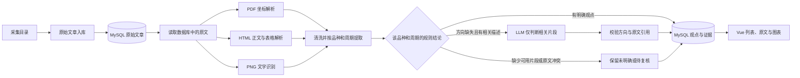

# 期货研报提取技术调研

## 技术结论

采用 **Python 提取、MySQL 8 存储、Vue 3 查询展示**。先把采集到的原始文章字节和来源信息入库，再由 Python 从数据库读取 PDF、HTML、PNG，提取并清洗内容。按「报告 × 品种或合约 × 周期」处理，规则直接提取明确观点。规则无法定向时，LLM 仅接收该条观点的相关片段进行兜底。入库和展示都标明观点来源。 [项目任务书](project/AI金融报告分析市场走势.docx)

| 阶段 | 确定采用的算法 | 输出或分流 |
| --- | --- | --- |
| 原始文章入库 | 有序目录遍历、字节特征识别、流式 SHA-256、按指纹保存原始字节 | MySQL 原文、实际格式、文件指纹、路径和采集日 |
| 待解析文章读取 | 按文章 ID 或批次查询 MySQL 原文字节并固定内容版本 | 原文、附件及其版本 |
| PDF 读取 | Poppler 字词坐标、表头列带、品种行带和正文版面区块 | 带页码和坐标的单元格或正文块 |
| HTML 读取 | BOM/meta 编码判定、正文模板选择、DOM 分块、表格占位网格 | 带小节或 DOM 位置的正文块和单元格 |
| PNG 读取 | Tesseract 中文和英文 OCR、TSV 字词框、按行或单元格还原 | 带像素坐标的正文块和单元格 |
| 元数据 | 标题区和正文元数据校验、机构别名归一化、文件名和目录兜底 | 机构、标题、发布日期和日期来源 |
| 品种和周期 | 别名最长匹配、合约格式校验、小节状态与显式周期继承 | 每条候选观点的品种、合约、周期及其依据 |
| 观点抽取 | 表格列语义、显式展望字段、分句和作用域规则 | 原文判断、条件、方向、理由和操作建议 |
| 候选合并 | 按品种和周期分组、按证据优先级合并、同级冲突保留待复核 | 可查询的观点及其证据 |
| LLM 兜底 | 按已定位的品种和周期选片段，校验结构化方向及逐字原文证据 | 独立标记的模型推断、未明确或待复核状态 |
| 导入和复跑 | 相对路径幂等、按报告加行锁、事务批量写入 | 当前有效结果、规则版本和导入记录 |
| 查询和统计 | MySQL 参数化过滤、游标分页、同周期机构等权计数 | 观点列表、详情、日度方向分布和覆盖情况 |
| 验收 | 人工标注、按报告组留出、逐字段和整条记录匹配 | 精确率、召回率、差错类型及覆盖报告 |

PDF 和 HTML 提取使用 Python 标准库和当前环境已有的 `pdftotext`。PNG 使用 Tesseract，扫描版 PDF 可复用同一套 OCR。MySQL 驱动和 Web 框架的实现选型见后文。表格扩展和通用网页提取器按实际覆盖情况评估。调研阶段仅验证了可直接运行的本地工具。

## 语料盘点与输入算法

扫描 `data/data1/` 和 `data/data2/` 的 31 个日期目录，识别了 9,330 个 `.PDF` / `.html` 文件，约 6.17 GB。按扩展名统计是 4,410 个 PDF 和 4,920 个 HTML。已解压目录中独立 `.png` 文件数为 0。最大样本约 39.4 MiB。实际分流要看文件头，扫描结果如下。

任务书、接口说明和样本链接指向本地课程资料，分别位于 `docs/project/` 和 `data/`。

| 文件扩展名 | 检出 PDF 文件头 | 检出 HTML 标记 | 其他 |
| --- | ---: | ---: | ---: |
| `.pdf`（忽略大小写） | 4,055 | 353 | 2 |
| `.html` | 9 | 4,911 | 0 |

这些是**字节级特征**。HTML 仍可能是正文、附件页或错误页。本地示例中，`恒泰期货_210639.PDF` 以 HTML 开头，`华龙期货_210915_0.html` 以 `%PDF-1.7` 开头。另两个 `.PDF` 样本分别是重复异常字节和纯文本 404 错误。按文件大小缩小比较范围后计算完整 SHA-256，确认 **157 组、共 1,384 个文件的内容重复**，其中 150 组跨采集日期或文件名前缀机构。按扩展名分层，从各自文件最多的 12 个机构在两批数据中各取一个中位文件。24 个 `.pdf` 样本的前两页中，22 个返回了可抽取文字，另外 2 个是 HTML 内容；24 个 `.html` 样本都能按 UTF-8 解码。分层抽查用于发现问题类型，覆盖率要用后续标注集测量。 [恒泰期货样本](../data/data1/20240301/恒泰期货_210639.PDF) · [华龙期货样本](../data/data1/20240301/华龙期货_210915_0.html) · [Python SHA-256 接口](https://docs.python.org/3/library/hashlib.html)

1. 原文导入命令从两个数据目录按相对路径排序遍历，归档包作为原始资料保留。候选扩展名包括 `.pdf`、`.html`、`.htm` 和 `.png`，忽略大小写。绝对路径解析后检查仍位于 `data/` 内，相对路径统一用 `/` 记录，并保留文件名大小写及原始字符。
2. 先匹配 PNG 八字节签名 `89 50 4E 47 0D 0A 1A 0A`，再在前 1 KiB 匹配 `%PDF-` 版本文件头，其余候选先处理 BOM，再在前 8 KiB 查找 HTML 标记。HTML 片段进一步交给 DOM 读取器确认。签名与扩展名不一致时按签名选读取器，同时记 `extension_mismatch`。空文件、已知错误正文和未知签名分别记录。 [PNG 文件签名](https://www.w3.org/TR/png-3/#5PNG-file-signature) · [PDF 文件头规范](https://opensource.adobe.com/dc-acrobat-sdk-docs/pdfstandards/pdfreference1.7old.pdf) · [HTML 编码和解析标准](https://html.spec.whatwg.org/multipage/parsing.html)
3. 用 1 MiB 数据块计算 SHA-256，按指纹保存原始字节，另按规范相对路径保存每份采集记录。解析任务只消费已入库的原文。相同指纹可以按解析版本复用正文读取，文件名、目录日期、相对附件和最终报告归属按各采集记录单独确定。机构和有效发布日期一致且指纹相同时标记为同一报告组，聚合只计一次。相同文件横跨日期目录且缺少原文日期时，保留采集日并标记日期待复核。 [Python 文件哈希示例](https://docs.python.org/3/library/hashlib.html#file-hashing)
4. 文件名按 `(.+?)_([0-9]+)(?:_([0-9]+))?` 完整匹配，取机构前缀、采集编号和可选序号。目录按日期格式解析为 `collected_on`。实际扫描中 9,330 个文件名均匹配，采集编号作为来源标识。新来源缺失命名字段时保留原始文件和路径，由元数据规则补充。采集导入和文章解析分别输出成功、跳过及失败记录。

## 可参考的公开项目

| 项目 | 与本项目的关系 |
| --- | --- |
| KSJW-F/Financial-Forecast | 最接近的完整项目。GitHub 与内网 `fzy/group5` 的 README、处理流程、方向规则、依赖和数据模型在统一换行后文本一致。流程包含正文提取、品种词表、分段、规则和 LLM 补充、入库及展示。仓库明确限制未经授权转载及使用，适合作为设计参考。 [GitHub 仓库](https://github.com/KSJW-F/Financial-Forecast) · [规则源码](https://github.com/KSJW-F/Financial-Forecast/blob/main/src/analyzer/rule_analyzer.py) · [处理流程](https://github.com/KSJW-F/Financial-Forecast/blob/main/src/pipeline.py) |
| FinEntity | EMNLP 2023 的金融新闻实体级情感任务，同时标金融实体原文范围和该实体的情感。可借鉴按目标分别标注并保留原文位置的做法。现有标签是正面、中性、负面，期货机构展望仍需用我们的品种、周期和方向口径标注。 [论文](https://aclanthology.org/2023.emnlp-main.956/) · [数据与代码](https://github.com/yixuantt/FinEntity) |
| Financial-Event-Extraction-Program | 中文财经新闻因果抽取。项目说明记录了分句、触发词、规则匹配和因果原文索引，可用于思考怎样给观点和理由各自保留证据。 [项目说明](https://github.com/xiaominglalala/Financial-Event-Extraction-Program#readme) |
| ReportClassifier | 中文研报因果知识抽取。它先按中文句号切句，实际模型使用 BGE 与 PyTorch，`sklearn.metrics` 用于评估。适合参考句级任务的组织方式。 [提取代码](https://github.com/zhiqix/ReportClassifier/blob/main/classify.py) · [模型](https://github.com/zhiqix/ReportClassifier/blob/main/model.py) · [评估代码](https://github.com/zhiqix/ReportClassifier/blob/main/utils.py) |
| Wind AliceMarket | 公开文档列出期货研报观点服务，聚合机构观点并输出多空分布与 Wind 情绪评分。可以参考图表的输出形式。公开资料能核实的是服务入口和输出。 [技能文档](https://github.com/Wind-Alice/AliceMarket/blob/main/skills/wind-alice/SKILL.md) |

## 宝城期货样本验证

在宝城期货 2024 年 3 月 1 日有色早报第 1 页，用表头和品种行定位后，核对得到下表。该次验证覆盖这份 PDF 的单页策略表，其他机构版式需用独立样本评估。 [宝城期货样本](../data/data1/20240301/宝城期货_210703.PDF)

| 品种 | 短期 | 中期 | 日内 |
| --- | --- | --- | --- |
| 铜 | 上涨 | 震荡 | 震荡偏强 |
| 锌 | 下跌 | 下跌 | 震荡偏弱 |
| 镍 | 上涨 | 震荡 | 上涨 |
| 黄金 | 上涨 | 上涨 | 震荡偏强 |

## 文件读取与版面解析

读取层接收从 MySQL 取出的原文字节和版本标识，统一输出带出处的正文块和表格单元格。正文块保留标题路径与顺序，表格保留行列、表头和原始单元格文本。PDF 出处用从 1 开始的页码和坐标框，HTML 用标题路径和元素顺序号，PNG 用原图像素坐标。同一块保留原文和供匹配的规范化文本，匹配侧做 Unicode NFKC、统一空白及常见全角标点，展示侧使用原文。 [Python Unicode 规范化](https://docs.python.org/3/library/unicodedata.html#unicodedata.normalize)

### PDF 文字层与策略表

1. **读取有坐标的文字。** Python 用 `subprocess` 将数据库中的 PDF 字节送入 `pdftotext -bbox-layout -enc UTF-8 - -` 的标准输入，从标准输出读取 XHTML。用 `xml.etree.ElementTree` 提取页、块、行和字词框，坐标按原始页尺寸保存。退出码异常、XML 解析失败或没有页节点时记录原因，尝试 `pdftotext -layout -enc UTF-8 - -` 的逐页正文读取。回退结果用于正文规则，PDF 表格需要可验证的列信息。已用宝城 PDF 的字节实测输入输出管道，第 1 页成功返回含「日内」表头的坐标结果。 [Poppler 参数手册](https://manpages.debian.org/bookworm/poppler-utils/pdftotext.1.en.html) · [Python XML 解析](https://docs.python.org/3/library/xml.etree.elementtree.html)
2. **识别策略表头。** 从相邻一至两条文本行寻找「品种」「合约」和至少一个方向周期列，如「日内」「短期」「中期」，并用整条表头的其他栏名作列锚点。只有在首列下方能识别至少一行品种或合约时，才把这一块交给表格解析。横轴按列中心排序，用相邻中心的中点初分列。首尾边界使用页内该表块或模板已识别的左右边界。存在明确表格竖线时，可以用已验证的模板坐标覆盖中点。 [pdfplumber 表格算法](https://github.com/jsvine/pdfplumber#extracting-tables)
3. **按品种锚点装配单元格。** 首列每个已识别品种或合约对应一个纵向行锚点。行间界线取相邻锚点中心的中点，表头、下一小节、页脚或下一张表限制表域。根据字词中心坐标落入的行带和列带分配词块。同一格先按原行的纵坐标、再按横坐标拼接，中文换行片段紧接，拉丁词间保留空格。来源框取该格字词框的并集。跨页默认重新匹配表头。只有重复表头或已验证模板能确认列对齐时，才继承上一页的列定义。
4. **校验单元格归属。** 提取时核对表头周期是否唯一、词块有无跨邻列、首列品种锚点是否能与候选行一一对应。空格保留为空，孤立续行和明显跨列的格子记为版面待复核。只对具有可确认的品种和周期的单元格输出方向候选，其余格子的失败原因独立保留。优先读同页可确认的正文小节。样式长期稳定的复杂表，可对比 `pdfplumber` 的 `lines`、`text` 或 `explicit` 表格策略，用带答案的样本验证后再采用。 [pdfplumber 表格设置](https://github.com/jsvine/pdfplumber#table-extraction-settings)

### PDF 正文与多栏阅读顺序

1. 策略表占用的字词先从正文候选中排除。以 Poppler 的块和行作为起始顺序，用坐标把同块内的行从上到下排列。页首、页尾文字只有在它跨页重复且匹配页码、机构眉标或免责声明等已知模板时才剔除。免责声明后的内容与正文分块，避免页内筛选误删正文。
2. 对双栏版式应用水平区间切分。在同页有并排正文块、横向区间不相交且纵向覆盖相交的区域，先依据列间空隙划分左右列，再逐列自上而下读取。通栏标题按其纵坐标将正文分为上下区域，避免把标题下的两列插到标题上方。重叠块导致列界不稳定时使用已验证的机构模板，仍无法定位就保留原始块顺序并标记阅读顺序待复核。
3. 对折行只在相邻两行属于同一列、同一段且中间没有新标题、项目编号或明显段间空白时拼接。表格、正文和附件拥有各自的位置标识，原文回查可定位到具体来源。 [Poppler 版面相关选项](https://manpages.debian.org/bookworm/poppler-utils/pdftotext.1.en.html)

### HTML 正文、表格与附件

1. **解码字节。** 有 BOM 时先按其编码解码。否则用 ASCII 兼容的预扫描读取文档头部 `meta charset` 或 `http-equiv` 的声明，将常见 `gb2312` 和 `gbk` 声明归到 `gb18030` 解码。声明缺失或严格解码失败时，依次尝试 UTF-8、GB18030。全部失败标为编码异常，保留文件记录供复核。数据是本地快照，实际采用的编码写进提取日志。 [WHATWG HTML 编码判定](https://html.spec.whatwg.org/multipage/parsing.html#determining-the-character-encoding) · [Python 标准编码](https://docs.python.org/3/library/codecs.html#standard-encodings)
2. **定位正文容器。** 采用 Python 标准库 `HTMLParser` 维护标签栈。依次匹配机构模板的正文容器、公众号 `#js_content` 或 `.rich_media_content`、语义明确的 `main` 或 `article`。多个通用容器都可用时，按正文可见字符数扣除链接文字数选取最高者，平分时取 DOM 顺序在前者。容器内忽略脚本、样式、导航、推荐阅读和隐藏节点，按 `h1`–`h6`、段落、列表、表格输出，不运行页面脚本。`HTMLParser` 给出标签和位置事件，工程实现需显式处理空元素，以及 `p`、`li`、`tr`、`td`、`th` 的常见隐式闭合。 [Python HTMLParser](https://docs.python.org/3/library/html.parser.html) · [WeKnora 公众号正文选择器](https://github.com/Tencent/WeKnora/blob/main/docreader/parser/web_parser.py)
3. **还原 HTML 表格。** 逐 `tr` 扫描单元格，为每格在当前行寻找最左可用槽位，按 `rowspan` 和 `colspan` 占用矩形区域，保留原格坐标和文本。无效跨度视为 1，`rowspan=0` 延伸到所在行组末尾。优先用 `thead`、`th`、`scope` 或 `headers` 建立方向列和品种行关系。多层表头用原格覆盖关系叠加父子标签。格子跨了多个不同周期且原文没有分别说明时，记录歧义。原始格重叠或表头关系缺失时保留表格原文，交人工核对。 [WHATWG 表格槽位算法](https://html.spec.whatwg.org/multipage/tables.html#forming-a-table)
4. **从数据库读取已有附件。** 正文空、仅说明下载，或表格内容明确位于附件时，从正文容器读取报告链接。相对链接去掉查询和片段、解码路径后，用 HTML 的采集路径归一化为 `data/` 下的逻辑相对路径，拒绝越出资料根目录的路径。按该路径查询原始文章表，并把附件的字节与版本交给相应读取器。证据同时保留 HTML 引用位置和附件实际位置。缺失附件和需要远端资源的页面记录为待补数据。通用正文模板覆盖不足时，可在相同样本上比较 Trafilatura 的正文和表格表现。 [Python URL 组件解析](https://docs.python.org/3/library/urllib.parse.html) · [Trafilatura 提取参数](https://trafilatura.readthedocs.io/en/latest/corefunctions.html)

### PNG OCR 与扫描版 PDF 分流

1. **独立 PNG。** 用签名和 `IHDR` 获取原图尺寸，把数据库原文字节送入 `tesseract stdin stdout -l chi_sim+eng --psm 3 tsv`。已识别为单栏文字块的区域可用 `--psm 6` 再识别。第一版保存原图像素坐标，裁剪重识别时把坐标加回裁剪偏移。命令须具备 `chi_sim` 和 `eng` 语言数据。 [PNG IHDR 规范](https://www.w3.org/TR/png-3/#11IHDR) · [Tesseract 命令参数](https://github.com/tesseract-ocr/tesseract/blob/main/doc/tesseract.1.asc) · [Tesseract 识别质量与分割模式](https://tesseract-ocr.github.io/tessdoc/ImproveQuality.html)
2. **复用版面规则。** 从 TSV 读取有文本的词级行，按页、块、段、行、词顺序组织正文，保留字词框和置信度。检测到「品种」及周期表头时，在原图坐标下应用 PDF 的列带和行带算法，重建方向单元格。位置不清或低置信度字词影响品种、周期、合约或方向时，保留图像区域和原识别文本，进入复核。 [Tesseract TSV 字段](https://tesseract-ocr.github.io/tessdoc/Command-Line-Usage.html#tsv-output)
3. **扫描版 PDF。** 逐页检查文字层，按需用 `pdftoppm -f N -l N -r 300 -png -singlefile -` 将数据库中的 PDF 字节渲染为单页 PNG。复用 PNG OCR，把识别坐标按页面和渲染图的尺寸映射回 PDF 坐标。文字层可读时继续使用 Poppler 抽取内容。已在宝城样本上验证该命令通过标准输入读取 PDF 字节，并从标准输出得到有效 PNG。 [Poppler pdftoppm 文档](https://manpages.debian.org/bookworm/poppler-utils/pdftoppm.1.en.html) · [Tesseract 分辨率建议](https://tesseract-ocr.github.io/tessdoc/ImproveQuality.html)

| 读取结果 | 第一版处理 |
| --- | --- |
| 文字层可读且版面可识别 | 走坐标表格或正文解析。 |
| 文字层可读但表格归属不清 | 保留正文候选和原页，待复核该表。 |
| PDF 无可见字词，或抽取含明显替换字符、私用字符等乱码 | 按页进入 OCR 候选。起始排查阈值为异常字符占可见非空白字符至少 5%，短页同时结合页图和版面检查。 |
| OCR 工具或语言数据缺失、识别超时、无可用字词 | 记录 OCR 的具体状态和错误，保留原图供复核。 |
| 文件损坏、加密失败或附件缺失 | 留存具体失败原因，与正文无方向分开计数。 |

已验证的是宝城期货单页 PDF 的坐标读取，以及本地大越期货、渤海期货两份 HTML 的 UTF-8 和 `#js_content` 特征。当前终端有 Poppler 工具，未找到 Tesseract 命令，已解压样本也没有独立 PNG。PNG 阶段需用真实 PNG 或从已标注页渲染的 PNG 进行 OCR 验收，并记录样本来源。跨页合并、多栏顺序和合并表头也需独立样本复核。 [大越期货样本](../data/data1/20240301/大越期货_210629_0.html) · [渤海期货样本](../data/data1/20240301/渤海期货_232095_2.html)

## 报告元数据提取

每个字段保存取值、来源和原文位置。日期用 Python `datetime` 做公历校验。原文与目录不一致时，以识别到的发布时间为准，保留采集日和差异。两个同级的原文日期冲突时，标为待复核。公告中的市场日期、合约年月、库存统计日和正文事件日不作为发布时间。 [Python 日期解析](https://docs.python.org/3/library/datetime.html#datetime.datetime.strptime)

| 字段 | 依次尝试的来源 |
| --- | --- |
| 机构 | 已知页面发布机构字段或 PDF 封面署名 → 文件名机构前缀。对两个来源用版本化别名表归一化。来源冲突时保留候选，交人工确认。 |
| 标题 | HTML 正文 `h1` 或模板标题 → `og:title` → 去除明确站名后缀的 `<title>`。PDF 优先取封面正文标题区，过滤免责声明、业务资格、通用栏目名。失败时展示文件名并标为兜底。 |
| 发布日期 | 页面明确的发布时间或 PDF 封面发文日期 → 标题中的完整日期 → 目录日期。接受 `YYYY年M月D日`、`YYYY-M-D`、`YYYYMMDD` 等可校验格式。已验证模板中的标准时间元数据换算成报告当地日期。原文只有月日且与目录月日一致时，补用目录年份并标注来源。 |

语料以中国期货机构为主。带时区的网页发布时间按中国标准时间（UTC+08:00）生成 `published_on`，原始时间另存。目录兜底可用于列表，重复文件跨日期、元数据冲突或日期不明的记录进入复核统计。文件发现到正文读取之间不因一个字段缺失放弃整份报告。

## 品种、合约和周期定位

### 品种与合约

维护 `product_id`、品种标准名、交易所、交易代码、可接受合约格式和别名词表。代码从交易所资料核对，别名从本地报告补充。识别时以 **显式合约 → 表格品种单元格或正文小节标题 → 句内明确品种 → 单品种报告标题** 的顺序确定观点归属。用 `re.finditer` 定位候选，对起点相同或范围重叠的别名优先保留最长有效匹配；英文代码带显式 ASCII 边界。标题进入新小节时清除上一节的品种和合约，跨页仅在明确识别为同一节续页时继承。 [上期所铜期货规则](https://www.shfe.com.cn/regulation/exchangerules/historicalversion/202508/t20250807_828528.html) · [郑商所甲醇规则](https://www.czce.com.cn/cn/uploadfile/2024/02/07/20240207154824122.pdf) · [EntityRuler 的重叠匹配](https://spacy.io/api/entityruler)

- 对 `CU2404`、`I2405` 先验证前缀在词表且月份为 `01`–`12`。对 `铜 2404` 只有在品种列、品种标题或与该品种明确绑定的合约位置才生成 `CU2404`。四位和三位数字合约依交易所配置分开校验，三位形式保留原代码，末位年份信息不足时交割年份留空。
- 「主力合约」在原文没有明确代码时记录为品种级观点，并保留「主力」原词。`铜强于锌`、`多铜空锌` 保存为相对观点或配对策略。只有原文分别给出两种商品的绝对走势时，才生成各自方向。
- 小节论述其他品种时，只有分句存在明确的主语和展望关系才切换目标。「钢材需求影响铁矿」等因素或比较既保留原文，也继续归属于明确的被分析品种。无法确定唯一目标的候选进入 `target_review`，不跨品种复制。

### 周期

按 **方向所在表头或字段 → 分句里的明确时间 → 其所属小节的周期标题 → 单周期报告标题中有明确标注** 的顺序取周期。同一报告的「日内、短期、中期」分别生成记录。保留报告对周期的定义，比如宝城期货「短期为一周以内、中期为两周至一月」。明确的数量和单位转为带比较符、上下限和单位的字段，如 `<=1w` 和 `2w–1mo`，月和周保留各自的单位。把「今日盘中」归到 `intraday`，把显式「短期」「中期」「长期」归到对应标签。「本周」「未来两周」使用各自的规范键，如 `week:this`、`future:2w`，保留原词及期限。缺少依据时用 `unspecified` 作为内部键，页面显示「周期未标注」。日期型标题中的日期只用于报告元数据，「早报」「日报」只作为文体，「近月」「远月」归到合约描述。 [宝城周期定义](../data/data1/20240301/宝城期货_210703.PDF)

## 方向、条件、理由和策略

### 候选生成和证据优先级

匹配用 NFKC 副本，展示用原始字词、单元格或句子。需要精确到词时，记录规范化片段到原始块范围的映射。标点和正文块用于断句，数字的小数点、合约代码、价格范围和表格续行留在原上下文。按品种小节执行顺序规则，每条候选都带 `rule_id`、证据等级和位置。 [Unicode NFKC 规范](https://www.unicode.org/reports/tr15/) · [Python 正则接口](https://docs.python.org/3/library/re.html)

| 顺序 | 识别规则 | 约束 |
| --- | --- | --- |
| A | 方向列单元格，或「日内观点」「中期观点」等带品种和周期的明确字段 | 捕获完整表达。策略列、历史涨跌列和指标列依据表头独立读取。 |
| B | 「后市展望」「预期」「核心观点」等明确判断段落 | 用局部规则确认句子对象是该品种价格或走势。展望字段同时含理由和建议时分句提取。 |
| C | 正文中的展望句，如「预计」「后市」「短期仍将」附近出现价格方向短语 | 同分句有品种或小节归属，且方向谓词修饰价格、行情、期价等走势目标。 |
| D | 标题中明确包含品种和展望方向 | 在正文缺少可确认观点时使用，保留标题证据。多品种标题按各分句独立判断。 |

显式观点字段先取完整值，再做整词或最长短语映射。「震荡偏强」归为看多，「震荡偏弱」归为看空，「区间震荡」「横盘」归为看震荡。裸词「上涨」「下跌」「偏多」「偏空」只在明确方向字段或合格展望句内输出。有「昨日」「收盘涨」等历史语境、纯供需叙述或策略词时，写入对应的行情、理由或策略字段。明确写出「中性」时保留原标签，只有同时明确表达区间或震荡才进入看震荡分布。价格区间、止损位和相对强弱也保留原文。 [Group 5 短语优先级及词频实现](https://github.com/KSJW-F/Financial-Forecast/blob/main/src/analyzer/rule_analyzer.py#L273)

### 分句作用域与冲突

- 用触发词与边界控制作用域。「若、如果、只有、除非」引入条件；保存条件分句及其对应结论。「但、不过、然而」、新主体和句末作为作用域边界，前句的条件和否定不自动作用到后句。对「不看涨」「难以继续上涨」保留否定原文，方向保持未明确，直到同一作用域内有肯定的方向判断。该思路借鉴 ConText 的触发词和终止词，期货词表由本地研报标注维护。 [ConText 原论文](https://pmc.ncbi.nlm.nih.gov/articles/PMC2757457/)
- 规则允许弃权。如果合格展望句仍无法定向，或可读正文只有相关因素和策略，记 `no_explicit_view` 并保留原文候选。页无法读取、品种无法确认、观点冲突各有独立原因码。规则直接提取的方向以明确展望句和观点字段为依据。 [规则弃权与冲突分析](https://snorkel.readthedocs.io/en/latest/packages/_autosummary/labeling/snorkel.labeling.LFAnalysis.html)
- 按 `(报告, 品种或合约, 周期)` 收集候选。对同一种条件和相同方向保留最高等级结论，合并多个证据位置。优先采用等级最高的明确结论。同级且同一条件内方向不一致时记 `direction_conflict`，主方向留空，候选及证据一并展示。低级证据与高级证据冲突时保留两者及来源标记。明确的无条件判断作为主观点，条件判断保留在明细。若只有条件分支且各分支方向不同，记录为多情景，主方向留空。
- 有方向的记录保留展望原文。理由优先取同一小节的「核心逻辑」「原因」「基本面」段，或与展望句直接相连的「因为」「由于」「受……影响」分句。遇到多条取直接关联且较早的至多三条原句，保留真实措辞和位置。操作建议、区间、止损从策略列或明确策略句提取，合约和条件跟随该句归属。 [财经文本因果证据索引参考](https://github.com/xiaominglalala/Financial-Event-Extraction-Program#readme)

例如大越铁矿石段落含「预计本周矿价维持震荡运行」和「区间逢高抛空」。输出 `week:this` 的「看震荡」，保存完整展望句，另记该合约的操作建议。宝城铜表的三列分别建观点，日内和短期虽然都归为看多，仍保存各自的原词和位置。 [大越铁矿石样本](../data/data1/20240301/大越期货_210629_0.html) · [宝城铜策略表](../data/data1/20240301/宝城期货_210703.PDF)

### LLM 兜底

1. **逐条判断是否兜底。** 规则完成该报告的全部候选合并后，逐个检查「品种或合约 × 周期」。有明确方向或可直接读出的条件观点时采用规则结果。仅当状态为 `no_explicit_view`、品种归属可靠且有相关分析描述时，才发起模型请求。版面不清、正文缺失、品种冲突和原文方向冲突走相应的复核流程。报告中某品种或周期已命中规则，其他范围仍独立判断是否需要兜底。
2. **按范围选原文。** 单次请求只处理一个品种或合约与周期。优先选同一小节里的展望、核心逻辑和与其相连的供需描述，最多选 3 个可定位的段落或表格单元，按原文顺序传入。每块带稳定的 `block_id` 和原始文本。没有标注周期时使用 `unspecified`，模型沿用该值。选择不到相关描述时保持未明确。
3. **约束模型输出。** 请求模型结合给定片段推断方向，返回 JSON，包含原 `scope_id`、`direction`、`evidence` 和简短 `inference_reason`。`direction` 允许 `bullish`、`bearish`、`range` 或 `null`。每条证据由 `block_id` 和逐字引用的 `quote` 组成。输入片段按资料处理，模型只能从这些片段引用。证据不足或只能得到相反的条件分支时返回 `null`，并保留条件或分歧说明。接口地址通过配置接入。接配套 SSE 接口时，按事件边界解析数据，拼接 `choices[].delta.content`，收到 `finish_reason=stop` 后再执行 JSON 校验。 [配套接口说明](<project/AI 接口说明文档.md>) · [SSE 事件解析规范](https://html.spec.whatwg.org/multipage/server-sent-events.html#parsing-an-event-stream)
4. **校验和记录。** 逐项校验 JSON、范围标识、方向枚举，以及每段引文是否出现在该 `block_id` 的原文中。有方向的结果要求至少一条可回查的证据。通过校验的有方向结果以 `source=llm` 入库，模型推断理由与原文引用分别保存。模型弃权保留未明确。接口失败、流中断或证据校验失败时记录原因，保持原来的规则状态。规则后来给出明确观点时，以规则结果更新展示，模型调用保留在历史记录中。

## 词表匹配的选项

首版可用 Python `re` 和少量别名词表。若测试发现词表匹配成为瓶颈，可以考虑 Aho–Corasick。它把多个词合成一棵前缀树，再通过失败指针复用部分匹配，一次扫描文本即可找到多个候选词及位置。词表输出仍需结合合约格式、标题位置与段落上下文判断归属。 [算法论文](https://doi.org/10.1145/360825.360855) · [Python 实现](https://github.com/WojciechMula/pyahocorasick)

## MySQL 数据模型与批量入库

采用 MySQL 8 InnoDB 和 `utf8mb4`。Python 用 MySQL Connector/Python 的参数绑定。路径、指纹、品种 ID 和周期等用于唯一性比较的字段使用二进制键或明确区分大小写的比较规则。日期用 `DATE`，查询时同时返回日期来源。字段及约束如下。 [MySQL Connector/Python 参数绑定](https://dev.mysql.com/doc/connector-python/en/connector-python-api-mysqlcursor-execute.html) · [MySQL 排序规则](https://dev.mysql.com/doc/refman/8.0/en/charset-collation-names.html)

| 表 | 主要字段和约束 |
| --- | --- |
| `raw_contents` | `content_hash BINARY(32)` 主键、`content LONGBLOB` 原始字节、字节数、实际格式、格式识别状态。相同字节共用一条内容记录。 |
| `raw_articles` | `id`、规范相对路径、`path_key BINARY(32)` 唯一索引、`content_hash` 外键、采集编号、采集日、声明扩展名和格式不匹配标记。`path_key` 是规范相对路径 UTF-8 字节的 SHA-256。同一路径的新内容更新指针，既有字节版本保留供回查。 |
| `reports` | `id`、唯一的 `raw_article_id`、上次成功解析的原文字节指纹和完整输入指纹、机构、标题、发布日、日期来源、解析版本、重复报告组键、已提交解析编号。 |
| `opinions` | `id`、`report_id`、`product_id`、`contract_key`、`period_key`、原周期、方向、来源 `source`、声明类型、复核状态、用于列表排序的报告日期。对 `(report_id, product_id, contract_key, period_key)` 建唯一索引。品种级用空字符串作为 `contract_key`，未标周期用 `unspecified`，两者在外部接口转为空值或可读标签。 |
| `opinion_evidence` | 外键 `opinion_id`、类型（展望／理由／策略／条件／模型引用等）、提取规则和等级、原文、证据的 `raw_article_id` 与 `content_hash`、页码及坐标、HTML 小节顺序号或 PNG 像素框。附件和条件分支分别留证。 |
| `analysis_attempts` | 解析编号、原始文章 ID、输入指纹、解析版本、开始与结束时间、处理状态、失败原因、耗时和结果数。 |
| `model_attempts` | 关联解析编号、品种或合约、周期、片段指纹、模型标识、提示模板版本、请求状态和校验原因。保留通过校验的结构化结果和推断理由，用于追查和幂等重跑。 |

方向列保存 `bullish`、`bearish`、`range` 或空值。`source=rule` 表示从原文提取，`source=llm` 表示模型推断，未产出方向时来源可为空。`review_state` 分为已识别、未明确、待复核。多情景和有条件判断通过声明类型及证据分支表示。无法读取或无法定位品种的报告在解析记录里保留原因。已确认品种且规则和兜底均未给出方向时，保留「未明确」及对应的正文位置。

### 原文入库与解析任务

1. **采集导入。** `ingest` 读取文件、校验实际格式并计算指纹，在一个事务中按指纹登记原始字节，再按路径登记来源和当前内容指针。路径和指纹均未改变时跳过。原始字节通过预处理游标的二进制参数写入 `LONGBLOB`。约 39.4 MiB 的最大样本要求客户端和服务端都能传输超过该文件大小的 SQL 包，部署验收以至少 64 MiB 的可用包大小为起点，并实测最大样本读写。元数据列表查询只选所需字段。 [MySQL 预处理游标](https://dev.mysql.com/doc/connector-python/en/connector-python-api-mysqlcursorprepared.html) · [MySQL BLOB 类型](https://dev.mysql.com/doc/refman/8.0/en/blob.html) · [MySQL 通信包限制](https://dev.mysql.com/doc/refman/8.0/en/packet-too-large.html)
2. **库内读取。** `analyze` 按 `raw_articles.id` 选取文章，通过 `content_hash` 联接 `raw_contents`。先读取元数据和字节，固定本次使用的文章与附件版本，再释放读取事务并运行解析器。将主文指纹以及按路径排序的附件路径和指纹组成固定字段顺序的 JSON 数组，再计算其 UTF-8 字节的 SHA-256。缺失附件保留路径并将指纹设为 `null`。完整输入、来源归属、规则版本及适用的模型和提示模板版本均与上次结果相同，且没有可重试范围时跳过。初始最多使用 4 个解析工作线程，单个外部提取命令初始限时 60 秒，分别记录数据库读取和解析耗时。
3. **提交分析结果。** 成功后另启事务，以固定顺序锁定用到的原文记录和 `reports` 行，检查本次输入仍然有效、且较新的解析尚未提交。输入已改变时将当前尝试标为过期，按新版本重新排队。有效时按观点唯一键批量插入或更新，替换当次解析的证据，移除本次结果中已不存在的旧观点，更新报告的成功输入指纹和版本后提交。相同业务键的观点 ID 保持稳定。 [MySQL 锁定读取](https://dev.mysql.com/doc/refman/8.0/en/innodb-locking-reads.html) · [MySQL 唯一键更新](https://dev.mysql.com/doc/refman/8.0/en/insert-on-duplicate.html)
4. **失败与复跑。** 读取或写入失败时记录具体状态。提交异常时先回滚，死锁或超时按同一解析编号最多重试两次，每次检查输入和当前成功版本。模型调用在结果写入事务外进行，同一范围、片段内容、模型和提示模板版本可复用通过校验的结果。模型失败保留规则已产出的观点及可重试状态，复跑只补处理相应范围。最近一次成功的观点及对应原文字节继续可查。`analyze --dry-run` 从数据库读入原文，输出规则结果和拟兜底范围供预览。 [MySQL 死锁处理](https://dev.mysql.com/doc/refman/8.0/en/innodb-deadlocks-handling.html)

## Python 查询接口与 Vue 展示

批处理提供 `ingest --limit` 原文导入、`analyze --article-id` 单篇解析和 `analyze --limit` 批量解析。两步均支持 `--dry-run`。导入预览列出文件和识别格式，解析预览按数据库文章 ID 读取原文并返回结果。查询接口选 FastAPI，客户端为 Vue 3。列表、详情和日度分布读取同一批已入库的观点。 [FastAPI 查询参数](https://fastapi.tiangolo.com/tutorial/query-params/) · [Vue 侦听和异步请求](https://vuejs.org/guide/essentials/watchers.html)

| 接口 | 具体做法 |
| --- | --- |
| `GET /opinions` | 按日期范围、机构、品种或合约、周期、方向、来源和复核状态组装参数化条件。排序用 `sort_day DESC, id DESC`。下一页条件用 `sort_day < cursor_day OR (sort_day = cursor_day AND id < cursor_id)`。游标带当前筛选条件摘要。一次最多 100 条。未知日期显示为空并排在末尾。 |
| `GET /opinions/{id}` | 返回观点、来源、原文、条件分支、理由、策略、原始文章 ID、内容版本和证据位置。模型结果显示「模型推断」，其推断理由单列。PDF 和 PNG 按证据指向的版本从数据库读取，分别定位页码或原图像素框。HTML 详情展示转义后的原文段落和小节，表格按抽取网格展示。 |
| `GET /opinion-trends` | 指定品种或合约、一个周期和日期范围，按下述规则计算各日方向分布。默认展示原文明确观点，模型推断可单独查询。支持从图表返回当天对应的明细。 |

给列表建 `(sort_day, id)` 索引，给常用的品种周期查询建 `(product_id, period_key, sort_day, id)` 索引。页面按日期和主键组合排序，`sort_day` 用发布日，发布日缺失时使用仅供排序的最小日期。显式日期筛选排除无发布日期记录。索引按实际筛选和 `EXPLAIN` 核对。Vue 在筛选变化时重置游标，并取消上一轮尚未完成的请求，避免旧结果覆盖当前筛选。 [MySQL 复合索引](https://dev.mysql.com/doc/refman/8.0/en/multiple-column-indexes.html) · [Vue 异步清理](https://vuejs.org/guide/essentials/watchers.html#side-effect-cleanup)

### 日度观点分布

先按同一品种或合约范围及周期筛选，再把内容相同且归属相同的报告按报告组归并。同名周期出现不同期限定义时，按规范期限分开展示，期限缺失也单列。以 `(发布日, 机构, 查询标的, 周期及期限定义)` 为桶，每家机构每天在同一查询口径下计一次。桶内无条件、可核对方向一致时归为看多、看空或看震荡。不同报告或合约方向不同且没有明确的品种总体观点时归为「机构内分歧」，保留明细。没有确定绝对方向的记录归入单独的未明确或待复核统计。条件分支默认只展示在详情，单独计覆盖情况。

每个日度点按来源返回 `bullish_count`、`bearish_count`、`range_count`、`mixed_count`、`unresolved_count`、`report_count` 及 `institution_count`。各方向占比以该来源当日三种有效方向的机构数为分母。原文观点图的分母为 0 时返回空值，Vue 显示「无明确观点」。模型推断使用单独的数据系列和分母。采集失败与没有报告分开标记。默认统计排除日期冲突、机构归属待复核和跨日期的未确认重复报告。机构明细页显示实际来源和排除原因。 [Group 5 趋势图实现](https://github.com/KSJW-F/Financial-Forecast/blob/main/app.py#L692) · [Wind 公开输出口径](https://github.com/Wind-Alice/AliceMarket/blob/main/skills/wind-alice/SKILL.md)

## 验收与技术升级条件

1. **试点集。** 从铜、铁矿石开始标注 20–30 份报告，覆盖 PDF 策略表、PDF 正文、网站与公众号 HTML，以及带清晰文字和表格的 PNG。加入错扩展名、无观点、跨日期重复文件、多周期、条件分支以及策略和展望并存的样本。宝城和大越样本用于重复验收；如需从已标注 PDF 渲染 PNG，将生成的样本标为派生样本，并与原 PDF 分在同一组。记录正确机构、日期、品种或合约、周期、方向、条件和原文位置。对有争议的表述先人工复核并补标注规则。
2. **独立评估。** 另留未参与调规则的报告。按内容指纹和已识别的转载组拆分，保证同源报告只在一边。测试集保留两批日期与不同机构模板，并单独列出未见机构的结果。正向结果按报告、品种／合约、周期和方向做一对一匹配。方向正确但对应到了其他周期或品种时，记录匹配失败及具体字段错误。对有条件的结论额外核对是否保留条件。
3. **指标。** 文件级统计读取成功率、错扩展名分流准确率和各类剩余问题。记录级统计 `precision=TP/(TP+FP)`、`recall=TP/(TP+FN)` 和各方向混淆，按机构、格式和周期切片。并列报告覆盖率、条件保留率、证据可回查率及未明确／待复核比例。试点参考门槛为已输出明确观点的精确率至少 90%、召回率至少 80%、可回查证据 100%，同时报告分子和分母。门槛用于评审，当前只有语料盘点和局部样例实测。 [信息检索精确率与召回率](https://nlp.stanford.edu/IR-book/pdf/irbookprint.pdf)
4. **入库与 OCR 验收。** 校验 PDF、HTML、PNG 从 MySQL 读回的字节 SHA-256 与源文件一致。原始文章入库后，用仅能访问数据库的环境运行解析，核对原文数据和附件均可读取。PNG 按真实与派生样本分别核对词框、品种、周期和方向。补测同路径改版、重复文件共用内容、附件版本变化以及事务失败恢复。
5. **兜底验收。** 用模拟接口核对明确观点的模型调用数为 0，同一文档中规则命中和未命中的范围独立处理。检查传入的片段归属和数量。覆盖有效响应、模型弃权、伪造引文、品种或周期串用、SSE 中断和重跑。分开衡量原文观点的提取准确率，以及人工复核的模型推断合理性、引文可回查率和兜底覆盖率。模型启用前后对比同一批样本。
6. **升级触发。** 错误集中在 PDF 错列时，用同一份表格答案比较 `pdfplumber` 的坐标和线条策略。未知 HTML 模板漏正文时，对比 Trafilatura 的正文与表格保留率。OCR 错误集中在换行、表格或特定字符时，用同样的 PNG 对比页面分割配置，记录方向准确率和运行耗时。

### 开发顺序

先完成原始文章入库和按数据库 ID 读取三种格式。接着用单篇解析预览核对规则结果和来源，并用模拟接口验证兜底分流。再验证批量解析、同路径改版、重复登记和事务失败恢复。最后接 Vue 的列表、证据详情和按来源查询的日度分布。每一阶段都用同一批带出处的样本比对，便于定位文件读取、观点规则或统计口径的差异。
